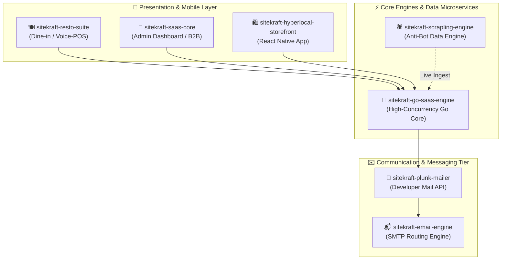

<div align="center">

# ⚡ Sitekraft Developer Ecosystem
### Complete Catalog, Architecture Directory & Multi-Tenant Infrastructure Suite

[](https://github.com/sarvasva-dev)
[](LICENSE)
[](#)

*An enterprise-grade directory of production-tested, white-labeled platforms, microservices, and AI-native developer tooling maintained by **Sitekraft**.*

---

</div>

## 📌 Ecosystem Overview & Repository Index

The table below outlines each core repository in the Sitekraft public suite, detailing the domain, target runtime, and primary capabilities.

| # | Repository | Domain / Focus | Key Tech Stack | Primary Capabilities |
|---|---|---|---|---|
| 1 | [**sitekraft-resto-suite**](https://github.com/sarvasva-dev/sitekraft-resto-suite) | Restaurant OS & POS | Next.js 15, React 19, NestJS, Supabase | Interactive Voice-to-Cart ordering, live Kitchen KDS (Kot/Kitchen Display System), multi-store admin portal, and table reservation workflows. |
| 2 | [**sitekraft-saas-core**](https://github.com/sarvasva-dev/sitekraft-saas-core) | Multi-Tenant Foundation | Next.js 16, React 19, Supabase RLS, Stripe | Complete tenant isolation, RBAC authentication, Stripe subscription billing, team invitation flow, and automated webhook verification. |
| 3 | [**sitekraft-hyperlocal-storefront**](https://github.com/sarvasva-dev/sitekraft-hyperlocal-storefront) | Mobile Marketplace | React Native, Expo, Redux Toolkit, Tailwind | Real-time multi-vendor hyperlocal storefront, live order telemetry, rider GPS tracking, and instant push notification dispatch. |
| 4 | [**sitekraft-scrapling-engine**](https://github.com/sarvasva-dev/sitekraft-scrapling-engine) | Data & Extraction Engine | Python 3.12, Playwright, Scrapy, FastMCP | Undetectable AI web extraction with Cloudflare/anti-bot bypass, automated proxy rotation, DOM parsing, and JSON-schema validation. |
| 5 | [**sitekraft-plunk-mailer**](https://github.com/sarvasva-dev/sitekraft-plunk-mailer) | Transactional Email API | Node.js, TypeScript, PostgreSQL, Redis | Developer-first transactional email delivery API, contact management, event tracking, and programmable drip-campaign orchestrator. |
| 6 | [**sitekraft-email-engine**](https://github.com/sarvasva-dev/sitekraft-email-engine) | High-Volume Mail Server | Go / Golang, Postal / SMTP, Docker | Self-hosted, high-deliverability transactional mail routing engine with SPF/DKIM/DMARC automated signing and rate-limiting queues. |
| 7 | [**sitekraft-go-saas-engine**](https://github.com/sarvasva-dev/sitekraft-go-saas-engine) | High-Concurrency Backend | Go (Golang), Fiber / Chi, PostgreSQL, React | Microsecond-latency multi-tenant API core, atomic ledger accounting, JWT-based tenant context, and high-throughput query handling. |

---

## 🏛️ Architecture & System Topology

The Sitekraft ecosystem is decoupled into specialized presentation layers and high-concurrency background microservices:



---

## 🚀 Deep-Dive: Repository Specifications

### 1. [`sitekraft-resto-suite`](https://github.com/sarvasva-dev/sitekraft-resto-suite)
* **Best Used For:** Restaurants, Cloud Kitchens, Cafes, and QSR chains needing an ultra-modern dine-in and takeout platform.
* **Standout Modules:**
  * **Voice-to-Cart AI Assistant:** Instant voice ordering with real-time speech transcription and item mapping.
  * **Kitchen Display System (KDS):** Real-time order dispatch with automated prep timers and status synching.
  * **Dynamic Menu & Table QR:** Multi-menu categories, customizable addons, dietary tags, and localized pricing.

### 2. [`sitekraft-saas-core`](https://github.com/sarvasva-dev/sitekraft-saas-core)
* **Best Used For:** Launching any B2B subscription software, CRM, or agency portal without rewriting auth, billing, or multi-tenancy.
* **Standout Modules:**
  * **Strict Tenant Isolation:** Built-in row-level security (RLS) preventing IDOR vulnerabilities.
  * **Stripe Billing:** Integrated tier limits, customer portals, and automatic billing suspension upon payment failure.
  * **Editorial Light Theme UI:** Tangible human-grade design built with Tailwind CSS and Radix UI primitives.

### 3. [`sitekraft-hyperlocal-storefront`](https://github.com/sarvasva-dev/sitekraft-hyperlocal-storefront)
* **Best Used For:** Grocery delivery, pharmacy courier, and neighborhood multi-vendor delivery applications.
* **Standout Modules:**
  * **Cross-Platform Native App:** Unified iOS and Android codebase powered by React Native and Expo.
  * **Geo-Fenced Cataloging:** Automated store inventory visibility based on rider radius and customer coordinates.

### 4. [`sitekraft-scrapling-engine`](https://github.com/sarvasva-dev/sitekraft-scrapling-engine)
* **Best Used For:** Competitive price monitoring, market research, and automated lead generation.
* **Standout Modules:**
  * **Anti-Bot Circumvention:** Transparent handling of JavaScript challenges, browser fingerprints, and CAPTCHA shields.
  * **AI Data Formatting:** Directly formats unformatted web pages into structured JSON schemas.

### 5. [`sitekraft-plunk-mailer`](https://github.com/sarvasva-dev/sitekraft-plunk-mailer) & [`sitekraft-email-engine`](https://github.com/sarvasva-dev/sitekraft-email-engine)
* **Best Used For:** Replacing expensive services like SendGrid or Resend with fully owned, zero-markup email infrastructure.
* **Standout Modules:**
  * **Template Builder & Event Ingest:** Webhook-driven open/click tracking with transactional templates.
  * **Carrier-Grade Deliverability:** Custom IP warm-up protocols, bounce handling, and automated DKIM rotation.

### 6. [`sitekraft-go-saas-engine`](https://github.com/sarvasva-dev/sitekraft-go-saas-engine)
* **Best Used For:** Backend services where Node.js latency or memory footprint is a bottleneck.
* **Standout Modules:**
  * **Zero-Allocation HTTP Routing:** Blazing fast responses (<2ms latency).
  * **Production Concurrency:** Thread-safe memory caching and atomic database write-locks.

---

## 🛠️ Unified Development Quickstart

To spin up a local development workspace across any repository:

```bash
# 1. Clone the desired repository
git clone https://github.com/sarvasva-dev/<repo-name>.git
cd <repo-name>

# 2. Install dependencies (Bun recommended)
bun install

# 3. Setup environment variables
cp .env.example .env

# 4. Launch the application
bun run dev
```

---

## 👨‍💻 Community & Maintenance

Maintained with ❤️ by the **Sitekraft Team**.  
For enterprise inquiries, private deployments, or custom integrations:
* **GitHub Profile:** [@sarvasva-dev](https://github.com/sarvasva-dev)
* **Organization:** Sitekraft Ecosystem
* **License:** Licensed under standard open and enterprise distribution terms.

---

## 🎬 Viral B2B Growth & Reel Playbook

Want to see how these open-source architectures are packaged into high-ticket client acquisition engines? Check our step-by-step conversion playbook:

👉 [**High-Converting B2B AI & SaaS Reel Playbook (Full Scripts, Hooks & DM Strategy)**](HIGH_CONVERTING_REEL_PLAYBOOK.md)

*Includes complete shot-by-shot video scripts for AI Phone Receptionists, Zero-Commission Restaurant POS, WhatsApp Lead Qualification, and Self-Hosted DocuSign alternatives.*
